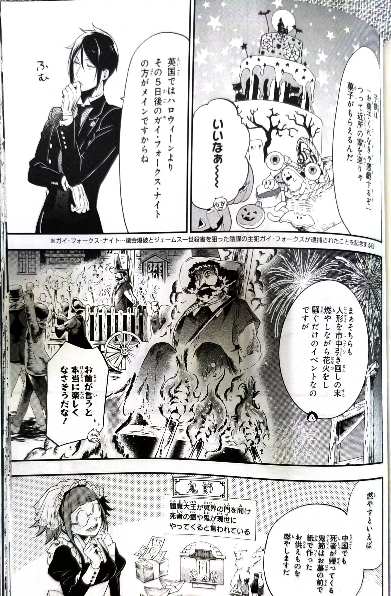
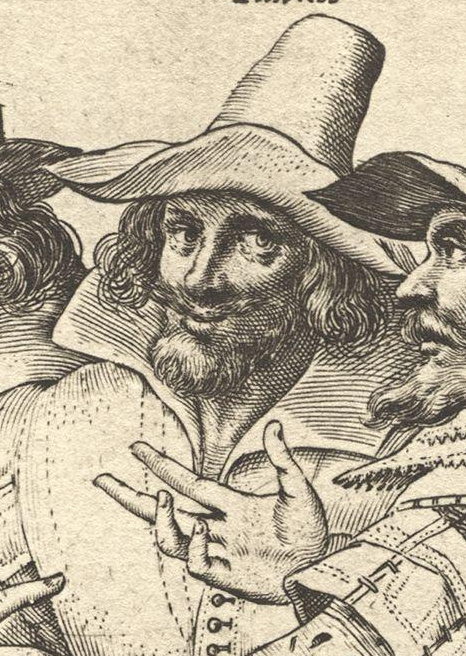
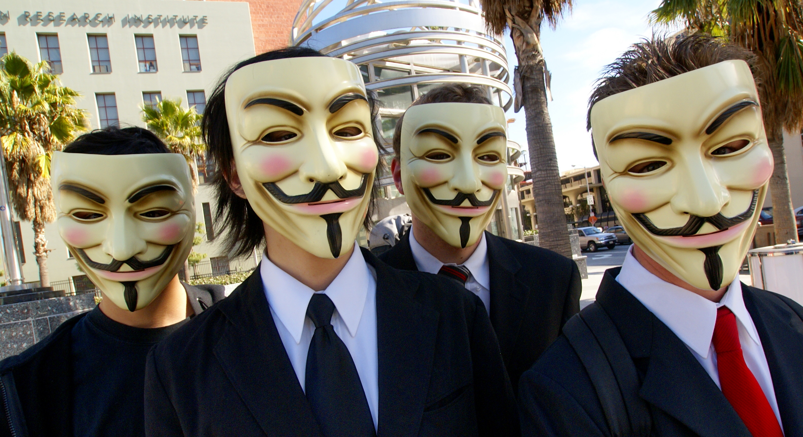
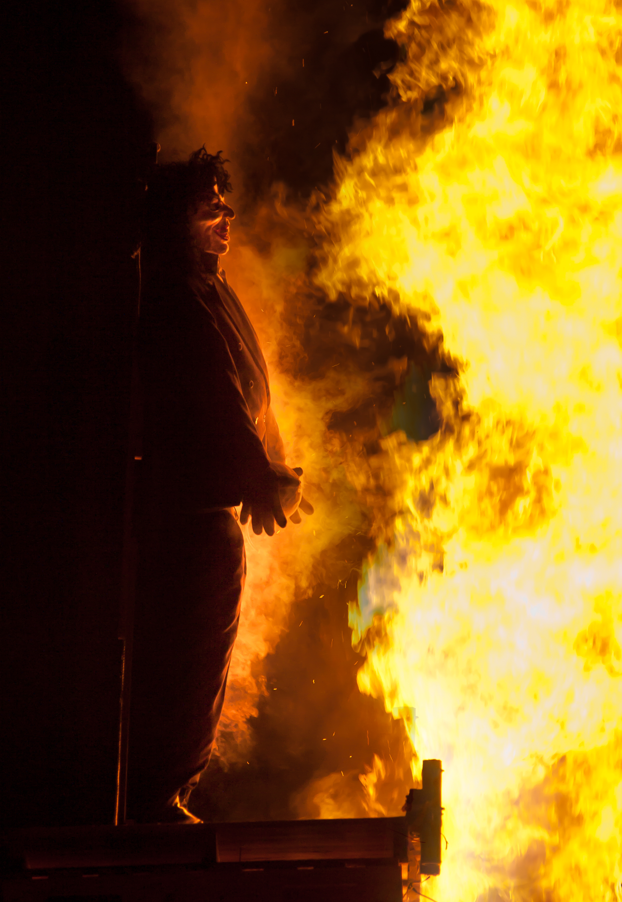

*英國每年11月5日舉行的公共節慶，起源於1605年火藥陰謀的失敗*

黑執事二十周年後緊接著是萬聖節活動，我想起了十年前黑執事第120話關於萬聖節的內容，對於賽巴斯口中的蓋•福克斯之夜感到好奇，甚至有一格分鏡也畫了燒人偶的場景，實在很有意思。在11月5日的今天也來聊聊這個英國的傳統。

*圖1｜賽巴斯提到蓋伊 • 福克斯節：引用自黒執事第120話*

## Guy Fawkes Night 是什麼？

**蓋·福克斯之夜**（Guy Fawkes Night），又稱**蓋·福克斯日**、**篝火之夜**（Bonfire Night)、**煙火之夜**(Fireworks Night)，是每年11月5日主要在大不列顛島舉行的紀念活動，按照傳統習俗人們會搭建篝火、燃放煙火、焚燒假人。它紀念的是1605年火藥陰謀的失敗，以及英王詹姆斯一世與國會沒有在爆炸中被殺死的結果。[1][3]

Guy Fawkes 是參與火藥陰謀的天主教陰謀者之一。他曾使用 John Johnson 這個名字，在國會地下空間看守火藥，準備於國會開幕時引爆；陰謀曝光後，他被逮捕，後來遭到處決。[1][3]

> **Remember, remember, the Fifth of November,**  
> **Gunpowder, treason and plot.**  
> — English traditional rhyme

## 1605年的火藥陰謀：Guy Fawkes 在國會地下做了什麼？

1605年，一群英格蘭天主教陰謀者計畫在國王與國會議員聚集時引爆火藥，殺死詹姆斯一世與國會中的重要人物，試圖改變當時的宗教與政治局勢。[1][3]

陰謀者把火藥藏在國會大樓地下的空間。Guy Fawkes 使用 John Johnson 這個名字，負責留在現場看守火藥。11月4日晚上，皇家官員 Thomas Knyvett 與 Edward Doubleday 在地下空間發現了他，以及放置在木柴下方的36桶火藥。[1]

Fawkes 原本要等到國會開幕時引爆火藥。國會原定在11月5日開會，因此陰謀若成功，國王、貴族與議員都可能在同一場爆炸中喪生。[1][3]

然而，到了11月5日，陰謀已經被查獲。其他陰謀者有人逃往英格蘭中部，後來有人在交戰中被殺，也有人被逮捕。原本預定發生爆炸的日期，從此成為「爆炸沒有發生」的紀念日期。[1]

### 1605年火藥陰謀的時間線

| 日期 | 事件 |
|---|---|
| 1605年 | 陰謀者計畫在國會開幕時引爆火藥，殺死詹姆斯一世與國會中的重要人物。 |
| 11月4日晚上 | Thomas Knyvett 與 Edward Doubleday 在國會地下空間發現 Guy Fawkes 與36桶火藥。 |
| 11月5日 | 原定國會開幕與引爆；陰謀已被發現，多數陰謀者開始逃亡。 |
| 1606年1月 | 國會通過 Thanksgiving Act，將11月5日固定為年度紀念日。 |

*圖2｜《The Gunpowder Plot Conspirators, 1605》的版畫。這類圖像讓陰謀者以一組人物被記錄下來，也能看出後世記憶並不只圍繞 Guy Fawkes 一人。來源：Wikimedia Commons／National Portrait Gallery NPG D2334，Public Domain。*

## 1606年以後：失敗的陰謀如何成為年度紀念日？

1606年1月，國會通過 Thanksgiving Act，使每年11月5日的禮拜與講道固定下來。教堂鐘聲、篝火與公共聚會，也逐漸成為這個日期的重要形式。[2][3]

最初的節慶帶有明確的政治與宗教立場。人們在固定日期重複紀念「國王與國會逃過陰謀」這件事；Thanksgiving Act 先確立紀念日期，禮拜與講道提供儀式，篝火與聚會則把紀念帶進更廣泛的公共空間。[2]

煙火也很早出現在慶祝活動中。到了後來，原本屬於政治事件的紀念逐漸發展成具有娛樂性、社區性與視覺特色的夜間節慶；但篝火與煙火仍然保留著「火藥陰謀失敗」這個歷史起點。[2][3]

Guy Fawkes 並不是陰謀的領袖；Robert Catesby 才是主要策畫者之一。Fawkes 之所以成為節慶最容易辨認的臉孔，是因為他在陰謀最關鍵的時刻守在火藥旁，並在陰謀被發現時成為最具戲劇性的現場人物。[3]

## 篝火上的 Guy 人偶是怎麼出現的？

今天的 Guy Fawkes Night 常見篝火、煙火和 Guy 人偶，但這些元素不是1605年當晚就完整出現的組合，而是在後來的紀念活動中逐步形成。[2][3]

早期被放上火堆的人偶，曾經代表教宗或魔鬼，反映了當時節慶中強烈的反天主教情緒。到了至少1790年，Guy Fawkes 的人偶逐漸成為11月5日篝火中的主要形象。[2][3]

這個變化讓 Guy Fawkes 從一名陰謀參與者，逐漸成為節慶裡人人都能辨認的人偶形象。節慶不只會重述一段歷史，也會把複雜的事件集中到一個可以被畫出來、做成模型、放進人群中的代表形象。

到了現代，大家常看到的那張白色、留著鬍子和尖鬍的面具，正是以 Guy Fawkes 為原型，再經《V怪客》（V for Vendetta）重新設計的面具。也就是大家常認作網路駭客團體 Anonymous 標誌的那一張；2000年代之後，Anonymous 將它帶進網路論壇與現場抗議，後來也成為 Occupy 等抗議運動常見的象徵。[3]

*圖4｜2008年2月10日，洛杉磯 Scientology 區域的 Anonymous 成員戴著 Guy Fawkes 面具。攝影：Vincent Diamante；來源：Wikimedia Commons，CC BY-SA 2.0。*

節慶的名稱分別突出了不同的面向：

- **Guy Fawkes Night**：以人物名稱稱呼這個夜晚；
- **Bonfire Night**：強調篝火是節慶的重要形式；
- **Fireworks Night**：強調煙火與夜間慶祝活動。

## 「penny for the Guy」：孩子如何把節慶帶進街區？

到了20世紀，孩子會用舊衣服、枕頭或報紙做出 Guy 人偶，推著它在街區裡行走，向路人喊：「penny for the Guy?」[4]

這筆錢有時用來買煙火，有時捐作公益，但更多時候成了孩子自己的零用錢。孩子製作人偶、帶著人偶出門、向大人索取硬幣，讓原本由國家與教會固定下來的紀念日，進入兒童、街區與家庭的日常生活。[4]

London Museum 保存的 Henry Grant 攝影資料，記錄了1950至1970年代倫敦街頭的這項習俗。照片裡的孩子帶著自製的 Guy，有時把人偶放在嬰兒車或推車裡，再向路人收取硬幣。這些影像讓我們看見，Guy Fawkes Night 並不只發生在大型公共活動中，也曾經由孩子帶進社區街道。[4]

「penny for the Guy」在20世紀末前後逐漸淡出；到了今天，Halloween 的 trick-or-treating 在兒童街頭活動中更常被看見。[4]

*圖3｜Guy Fawkes 人偶。人偶把歷史人物轉化成可以被製作、搬運與放上篝火的節慶形象。來源：Wikimedia Commons，William Warby，CC BY 2.0。*

## Halloween 與 Guy Fawkes Night 的不同

Halloween 的常見參與形式是裝扮、拜訪與交換。它的歷史背景可追溯到 Samhain、All Hallows’ Eve、guising 與 souling 等傳統；「trick or treat」這個說法在20世紀才出現，並在第二次世界大戰後逐漸普及。[5]

Guy Fawkes Night 的核心則是紀念1605年火藥陰謀失敗，並透過篝火、煙火與 Guy 人偶延續這段歷史。兩個節日都可能讓兒童走上街道，也都會讓普通的夜晚出現裝扮、聚會或交換，但它們要記住的內容不同：Halloween 主要圍繞裝扮與拜訪形成參與形式，Guy Fawkes Night 則從一段政治事件發展出年度公共紀念。[3][5]

## 重點整理

- Guy Fawkes Night、Bonfire Night 和 Fireworks Night 都是11月5日年度節慶的名稱。
- 節慶起源於1605年火藥陰謀失敗；1606年的 Thanksgiving Act 使11月5日成為固定紀念日。
- 禮拜、講道、鐘聲、篝火與煙火，逐步把政治事件轉化為公共節慶。
- Guy Fawkes 大約自1790年起成為篝火人偶的主要形象。
- 「penny for the Guy」讓孩子以自製人偶、街區行走與索取硬幣的方式參與節慶。

## Sources

[1] https://www.parliament.uk/about/living-heritage/evolutionofparliament/parliamentaryauthority/the-gunpowder-plot-of-1605/overview/the-plot-and-its-discovery/discovery-and-flight1 — UK Parliament: Discovery and flight
[2] https://www.parliament.uk/about/living-heritage/evolutionofparliament/parliamentaryauthority/the-gunpowder-plot-of-1605/overview/aftermath/commemoration- — UK Parliament: Commemoration of the Gunpowder Plot
[3] https://www.londonmuseum.org.uk/collections/london-stories/symbolism-of-guy-fawkes — London Museum: The symbolism of Guy Fawkes
[4] https://www.londonmuseum.org.uk/collections/london-stories/penny-for-the-guy-lost-bonfire-night-tradition — London Museum: Penny for the Guy
[5] https://www.smithsonianmag.com/history/celtic-origins-trick-treating-halloween-180984916 — Smithsonian Magazine: The Celtic Origins of Trick-or-Treating

## 圖像來源

- 圖1：使用者提供之《黑執事》第120話畫面，作為文章的情境入口。
- 圖2：*The Gunpowder Plot Conspirators, 1605*，National Portrait Gallery NPG D2334，Wikimedia Commons，Public Domain。
- 圖3：William Warby，*Guy Fawkes effigy*，Wikimedia Commons，CC BY 2.0。
- 圖4：Vincent Diamante，*Anonymous at Scientology in Los Angeles*，Wikimedia Commons，CC BY-SA 2.0。拍攝於2008年2月10日；圖片中為戴著 Guy Fawkes 面具的 Anonymous 成員。
